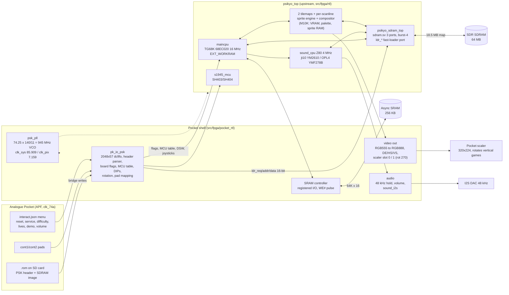

# Psikyo 68k → Analogue Pocket: Porting Design

Upstream: [`ppriest/Arcade-Psikyo_MiSTer`](https://github.com/ppriest/Arcade-Psikyo_MiSTer) (GPL-3.0),
vendored under `upstream/Arcade-Psikyo_MiSTer` (commit in `upstream/UPSTREAM_COMMIT`).

The upstream README lists "Port to the Analogue Pocket (openFPGA) — looking unlikely" as a TODO,
because the DE10-nano build uses 26,034 ALMs and 358 M10K blocks, against the Pocket's 18,480 ALMs
and 308 M10K. Most of that is the MiSTer framework (`sys/`: scaler, HDMI, OSD, rotation
framebuffer) and debug instrumentation, not the arcade hardware itself. This document records how
the port fits anyway.

---

## 1. Hardware being emulated

| Component | Original | Upstream implementation |
|---|---|---|
| Main CPU | 68EC020 @ 16 MHz | TG68K.C (`rtl/cpu/maincpu.sv`) |
| Sound CPU | Z80 @ 4 MHz (banked) | T80 (`rtl/sound/sound_cpu.sv`) |
| Sound (SH201B/KA302C) | YM2610 | jt10 + jt49 |
| Sound (SH403/SH404) | YMF278B (OPL4, PCM only) | `rtl/sound/opl4/` |
| Security (SH403/SH404) | MCU | `rtl/cpu/s1945_mcu.sv` (table-driven) |
| Video | PS2001B/PS3103/PS3204/PS3305 | 2 tilemaps + per-scanline sprite engine |
| Screen | 320×224 @ 7.159 MHz, 456×262 total (~59.9 Hz) | `rtl/video/video_timing.sv` |

---

## 2. Measured fit of the bare core on the Pocket FPGA

`psikyo_top` alone (no `sys/`, no screen rotator, no CRT offset, no hiscore, no debug tracer),
compiled by Quartus 25.1 Lite for `5CEBA4F23C8`:

| Resource | Bare core | Pocket total |
|---|---|---|
| ALMs | 13,146 (71 %) | 18,480 |
| M10K blocks | 287 (93 %) | 308 |
| DSP blocks | 29 (44 %) | 66 |

Logic fits with ~5k ALMs to spare for the APF bridge, loader and audio path. Block RAM does not
leave enough room, so the largest RAM moves off-chip (section 5).

M10K breakdown (top consumers):

| RAM | Size | M10K |
|---|---|---|
| 68020 work RAM `u_workram` | 64K × 16 (128 KB) | **128** |
| Tilemap VRAM ×2 | 4K × 16 each | 32 |
| Video registers / line scroll | 8K × 16 ×2 | ~32 |
| Sprite RAM (live + snapshot) | 4K × 16 ×2 | ~36 |
| Palette | 4K × 16 | 16 |
| Sprite line list | 1K × 76 | 8 |
| Z80 RAM, jt10 shift registers, misc | — | ~35 |

---

## 3. Solution architecture



Boot sequence: the Pocket streams the `.rom` into `pk_io_psk`, which holds `ldr_active`
(so the core stays in reset), latches board flags / DIPs / rotation from the header, writes the
SH404 MCU table, and copies the SDRAM image through the upstream fast-loader port. When the slot
completes and the FIFO drains, `boot_done` releases the core reset.

---

## 4. MiSTer → Pocket mapping

| MiSTer subsystem | MiSTer implementation | Pocket replacement |
|---|---|---|
| Host / ROM download | `hps_io` ioctl, DDR3 fast-load (`rom_loader.sv`) | APF bridge data slot → `pk_io.sv` → existing `ioctl_*` byte stream |
| Board flags / MCU table | `.mra` `<rom index="1">` | `.rom` header (board blob area) streamed as ioctl index 1 |
| DIP switches | ioctl index 254 | `.rom` header defaults + `interact.json` overrides |
| Video scaling | `sys/ascal`, HDMI | APF native 24-bit RGB video, Pocket scaler |
| Vertical games | `screen_rotate_two` into DDR3 framebuffer | `video.json` scaler modes with `rotation: 270`, chosen per game; **no framebuffer** |
| CRT Offset | `crt_adjust.sv` | dropped (no analog out) |
| Audio | `sys/` I2S/HDMI | `sound_i2s.sv`, 48 kHz, linear resampler (SpaceFish) |
| Work RAM (128 KB) | M10K | Pocket async SRAM (`sram_*`, 256 KB, 10 ns) |
| ROM / gfx / samples | SDRAM daughterboard 32 MB | Pocket SDRAM 64 MB (same SDR type) |
| Hiscore | `hiscore.v` + HPS upload | dropped for v1; candidate: APF nonvolatile save slot |
| Pause | OSD button | Start+Select chord |

---

## 5. Memory plan

### SDRAM (`dram_*`, 64 MB, 16-bit SDR)

Unchanged from upstream: Sorgelig's `sdram.sv` (burst-4 extension), 3 ports, 18.5 MB map
(`docs/phase1_sdram_map.md`). The Pocket chip has a 10-bit column; the controller's 9-bit
column simply addresses the low 32 MB, which already covers the whole map. The SDRAM clock is the
same PLL output phase-shifted, re-tuned for the Pocket board.

| Region | Base | Size |
|---|---|---|
| maincpu | `0x0000000` | 2 MB |
| audiocpu | `0x0200000` | 256 KB |
| sprites | `0x0240000` | 8 MB |
| tiles | `0x0A40000` | 4 MB |
| samples (ADPCM-A / OPL4 wave) | `0x0E40000` | 4 MB |
| spritelut | `0x1240000` | 256 KB |

### Async SRAM (`sram_*`, 128K × 16)

Hosts the 68020 work RAM (`0xFE0000–0xFFFFFF`, 64K × 16), using UB/LB for byte writes. This frees
128 M10K, leaving ~150 for the Pocket shell. `psikyo_core.sv` gets a `EXT_WORKRAM` parameter that
exports the work RAM port instead of instantiating `dpram`. `maincpu.sv` reads at `acc_ph==2`
(two `clk_sys` cycles ≈ 23 ns after the address); with registered SRAM I/O this is extended by one
phase for work RAM reads only (`acc_ph==3`) to keep a comfortable margin over the 10 ns SRAM
plus pad delays. Writes are driven by a small controller that asserts `WE#` only while address and
data are already stable.

### PSRAM (`cram0/1`)

Not needed: the upstream already replaced its whole-frame sprite buffer with a per-scanline
renderer, and rotation is done by the Pocket scaler.

---

## 6. Clocks

The upstream derives every enable (68020 16 MHz, Z80 4 MHz, YM2610 8 MHz, OPL4 33.8688 MHz,
pixel 7.159 MHz) by Bresenham from `clk_sys = 945/11 MHz`. That frequency is reachable **exactly**
from the Pocket's 74.25 MHz:

```
f_vco   = 74.25 MHz × 140 / 11 = 945.000 MHz   (600–1300 MHz VCO range)
clk_sys = 945 / 11  = 85.909091 MHz            (identical to MiSTer)
clk_sdr = 945 / 11  = 85.909091 MHz, phase-shifted (SDRAM clock pin)
clk_pix = 945 / 132 = 7.159091 MHz             (APF video clock, = clk_sys / 12)
clk_pix_90 = clk_pix + 90°                     (APF DDR video sampling)
```

So no divider constant in the upstream RTL changes. Audio uses a separate PLL for the
12.288 MHz I2S MCLK, as in SpaceFish.

**Timing risk:** upstream closes 85.9 MHz on the DE10-nano (speed grade 7) with +0.22 ns of
slack. The Pocket part is speed grade 8 (≈10–15 % slower), so the critical paths must be
reworked (see section 9).

---

## 7. ROM format (`.rom`)

Built by `tools/build_rom.py` from the upstream `.mra` files and MAME zips:

| Offset | Size | Field |
|---|---|---|
| 0 | 4 | magic `PSK\x01` |
| 4 | 1 | board flags (`.mra` index 1, byte 0) |
| 5 | 1 | header version (1) |
| 6 | 2 | board blob length |
| 8 | 4 | payload length |
| 12 | 4 | payload CRC32 |
| 16 | 8 | DIP switch defaults |
| 24 | 1 | rotation (1 = vertical, from `<rotation>`) |
| 25 | 7 | reserved |
| 32 | 512 | board blob (flags + SH404 MCU table), zero padded |
| 544 | n | `.mra` index 0 stream (SDRAM image) |

`pk_io_psk.sv` parses the header itself (flags, DIPs, rotation), writes the MCU table from the
board blob, and copies the SDRAM image through `psikyo_top`'s fast-loader port (`ldr_*`, 16-bit
writes, the port upstream uses for its DDR3 copy), applying the samuraia ADPCM-A bit swap on the
way. The core logic does not change.

---

## 8. Inputs

| Pocket | Arcade |
|---|---|
| D-Pad | 8-way joystick |
| Y / B / A | Buttons 1 / 2 / 3 |
| X / L / R | Buttons 4 / 5 / 6 (Battle K-Road) |
| Start | 1P Start |
| Select | Coin |
| Start + Select | Pause |
| L2 / interact menu | Service / test |

Player 2 maps from a second docked controller (`cont2_key`).

---

## 9. Work plan

1. **Timing closure at 85.9 MHz on C8.** Use the upstream SDC multicycles (68020, Z80, jt12,
   OPL4 PCM, palette path), then pipeline any path still failing. Fallback: run `clk_sys` lower
   and rescale the Bresenham constants (they are all parameters of one denominator).
2. **SRAM work RAM** (`EXT_WORKRAM`), with a BIST at boot as in SpaceFish.
3. **Pocket top** `psikyo_pocket_top.sv`: PLL, `pk_io`, SDRAM pins, SRAM, video (RGB555→RGB888,
   DE/HS/VS, scaler slot per game), audio resampler, inputs.
4. **APF metadata**: platform `psikyo`, core `danimanx.TengaiPoketto`, one instance JSON per
   game, `video.json` with horizontal and rotated modes.
5. **Hardware bring-up**: Tengai first (SH404: MCU + OPL4 + gfx banking, the hardest board), then
   Strikers 1945, Gunbird, Battle K-Road and Samurai Aces.
