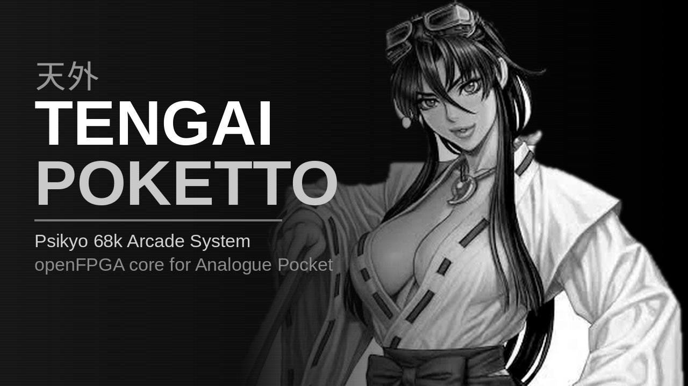

# TengaiPoketto

  

An openFPGA port of the **Psikyo 68k arcade system** (1993–1996) for the **Analogue Pocket**, based on [`ppriest/Arcade-Psikyo_MiSTer`](https://github.com/ppriest/Arcade-Psikyo_MiSTer).

> **Status: work in progress.** The port is in the design / bring-up phase. No bitstream has been released yet.

## Target games

| Game | Setname | Board | Sound |
|---|---|---|---|
| Samurai Aces / Sengoku Ace | `samuraia`, `sngkace` | SH201B | YM2610 |
| Gunbird | `gunbird` | KA302C | YM2610 |
| Battle K-Road | `btlkroad` | KA302C | YM2610 |
| Strikers 1945 | `s1945` | SH403 / SH404 | YM2610 / YMF278B |
| Tengai / Sengoku Blade | `tengai`, `sngkblade` | SH404 | YMF278B (OPL4) |

## Porting plan

See [`PORTING.md`](PORTING.md) for the hardware mapping (MiSTer → Analogue Pocket), the FPGA resource budget and the clocking plan.

## License & Credits

- Port developed by **DanimanX**.
- Original Psikyo MiSTer core by **Paul Priest** ([Arcade-Psikyo_MiSTer](https://github.com/ppriest/Arcade-Psikyo_MiSTer)), vendored under `upstream/`.
- TG68K.C by **Tobias Gubener**, T80 by **Daniel Wallner**, jt10/jt49 by **Jose Tejada**, SDRAM controller by **Sorgelig**.
- openFPGA APF framework by **Analogue**.
- Licensed under the **GNU General Public License v3.0 (GPL-3.0)**.

Game ROMs are copyrighted and not included.
