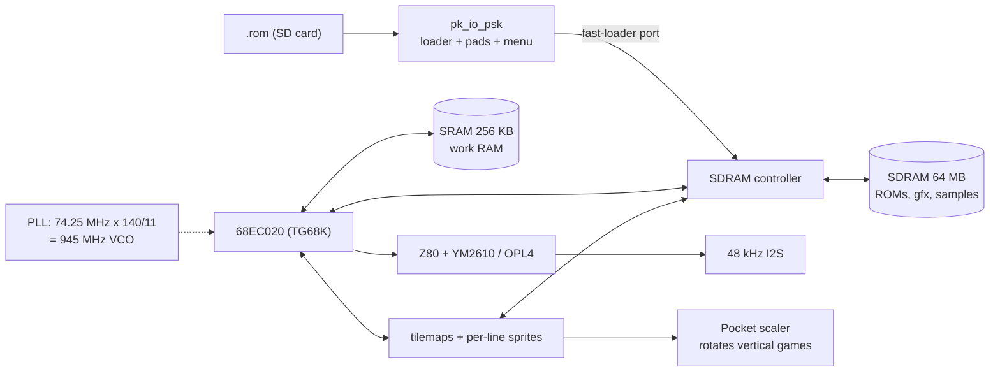

# TengaiPoketto

<p align="center">
  
</p>

An openFPGA port of the **Psikyo 68k arcade system** (1993–1996) for the **Analogue Pocket**, based on [`ppriest/Arcade-Psikyo_MiSTer`](https://github.com/ppriest/Arcade-Psikyo_MiSTer).

> **Status: v0.1.0, untested on hardware.** The full Pocket build meets timing at 85.909 MHz in every corner and the Verilator suite (`sim/run_tests.sh`) passes. The next step is hardware bring-up, starting with Tengai.

## Target games

| Game | Setname | Board | Sound |
|---|---|---|---|
| Samurai Aces / Sengoku Ace | `samuraia`, `sngkace` | SH201B | YM2610 |
| Gunbird | `gunbird` | KA302C | YM2610 |
| Battle K-Road | `btlkroad` | KA302C | YM2610 |
| Strikers 1945 | `s1945` | SH403 / SH404 | YM2610 / YMF278B |
| Tengai / Sengoku Blade | `tengai`, `sngkblade` | SH404 | YMF278B (OPL4) |

## How it fits on the Pocket



- **Clock:** 945/11 = 85.909 MHz, exactly the MiSTer `clk_sys`, so every upstream clock divider is unchanged.
- **Block RAM:** the 128 KB 68020 work RAM moves to the Pocket's async SRAM, freeing 128 of the 308 M10K blocks.
- **No framebuffer:** sprites are rendered per scanline and vertical games are rotated by the Pocket scaler.

See [`PORTING.md`](PORTING.md) for the full diagram, the hardware mapping (MiSTer → Analogue Pocket), the measured FPGA resource budget and the clocking plan.

## Installing

1. Build the package with `python3 tools/package_pocket.py`, then extract `release/TengaiPoketto_Pocket_v0.1.0.zip` to the root of the SD card.
2. Build the `.rom` files (below) and copy them to `Assets/psikyo/common/`.

## Building ROMs

```bash
python3 tools/build_rom.py --all upstream/Arcade-Psikyo_MiSTer/releases /path/to/mame/zips roms/
```

## License & Credits

- Port developed by **DanimanX**.
- Original Psikyo MiSTer core by **Paul Priest** ([Arcade-Psikyo_MiSTer](https://github.com/ppriest/Arcade-Psikyo_MiSTer)), vendored under `upstream/`.
- TG68K.C by **Tobias Gubener**, T80 by **Daniel Wallner**, jt10/jt49 by **Jose Tejada**, SDRAM controller by **Sorgelig**.
- openFPGA APF framework by **Analogue**.
- Licensed under the **GNU General Public License v3.0 (GPL-3.0)**.

Game ROMs are copyrighted and not included.
